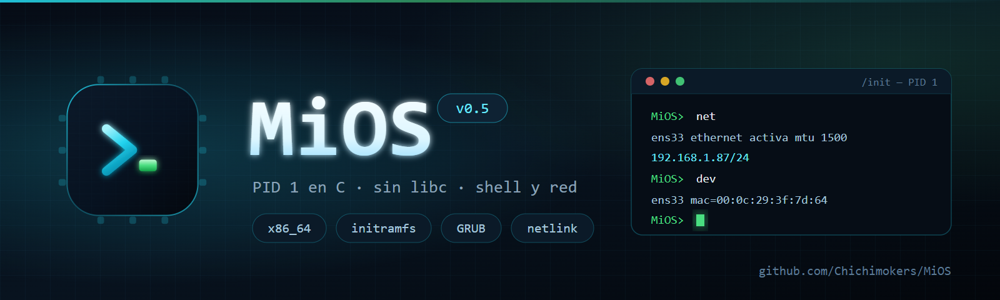
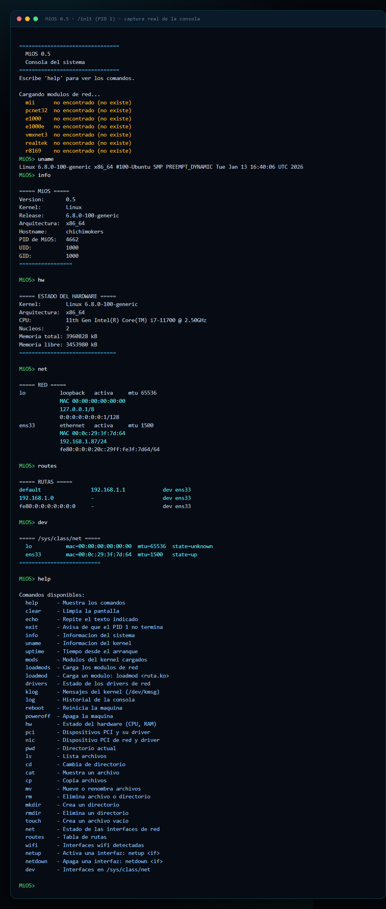
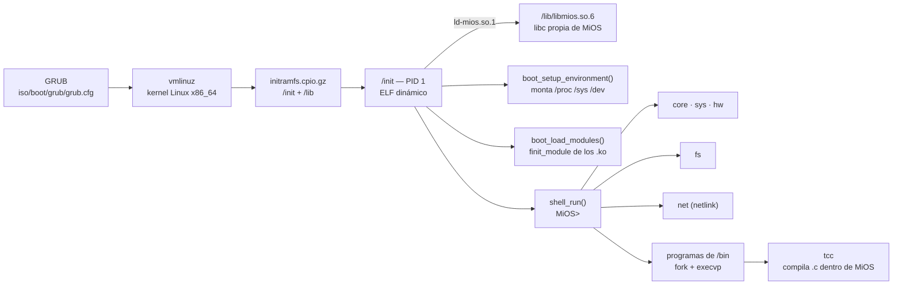

<div align="center">



**Sistema operativo mínimo para x86_64: el PID 1 es un programa en C, estático y sin libc.**


</div>

---

## ¿Qué es MiOS?

**MiOS** es un sistema mínimo que arranca sobre el kernel Linux: en vez de usar
`systemd`, `busybox` o cualquier userspace tradicional, el **PID 1 lo escribe
el propio proyecto en C**, **sin libc** (`-nostdlib -ffreestanding`). Todo lo
que el sistema necesita —consola, lectura de `/proc` y `/sys`, sistema de
archivos, módulos del kernel y red— se pide directamente al kernel con
**syscalls x86_64**.

Tampoco usa la libc del anfitrión: MiOS trae **su propia librería
(`libmios.so.6`)** y **su propio cargador dinámico (`ld-mios.so.1`)**, y sus
programas se compilan con **`mios-gcc`** contra un *sysroot* propio. Es el
primer escalón hacia el [self-hosting](docs/PLAN-TOOLCHAIN.md).

El resultado es un `init` de ~43 KB (más `libmios.so.6`, ~30 KB, y el cargador,
~10 KB) que arranca desde una ISO con GRUB, monta `/proc`, `/sys` y `/dev`,
carga los módulos de red del `initramfs`, deja al usuario en una shell propia
con **34 comandos** internos **y la posibilidad de lanzar programas** de `/bin`
(`fork` + `execvp`), más un `/etc/autorun` opcional. La ISO trae además **su
propio compilador de C (`tcc`)**, que compila y enlaza dentro de MiOS.

```
================================
  MiOS 0.5
  Consola del sistema
================================
Escribe 'help' para ver los comandos.

Cargando modulos de red...
  e1000    cargado
  e1000e   ya estaba cargado
MiOS> info
```

## Captura real de la consola

Salida **real** del `/init` de MiOS ejecutándose (banner, `uname`, `info`, `hw`,
`net`, `routes`, `dev` y `help`):

<div align="center">

</div>

> La captura viene de ejecutar el binario real `initramfs/init` con el kernel
> `6.8.0-100-generic` del anfitrión. Por eso la carga de módulos aparece como
> *no encontrado*: en la ISO esos `.ko` sí están dentro del `initramfs`, en
> `/lib/modules/<release>/`.

## Características

| Área | Qué hace |
| --- | --- |
| **Arranque** | Monta `proc`, `sysfs` y `devtmpfs`; crea `/dev/console` si falta y muestra el banner |
| **Sin libc del host** | Trae **su propia libc dinámica** (`libmios.so.6`) y **su propio cargador** (`ld-mios.so.1`) |
| **Toolchain propio** | `mios-gcc` + sysroot (`include/`, `crt1.o`, `libmios`) para compilar programas para MiOS |
| **Compilador dentro de MiOS** | `tcc` 0.9.27 portado: `/bin/tcc` compila y enlaza sobre `libmios.so.6` (sin binutils), y produce ejecutables que arrancan con `ld-mios.so.1` |
| **Self-hosting en C** | Las fuentes de `tcc` van en la ISO (`/usr/src/tcc/`): `tcc` se compila a sí mismo dentro de MiOS y el `tcc` resultante compila programas |
| **Editor de texto** | `edit`: editor en consola a pantalla completa (estilo `nano`) para escribir ficheros dentro de MiOS |
| **Shell propia** | Parser de línea + registro de comandos por subsistemas (`shell_register`) |
| **Módulos** | Carga `.ko` con `finit_module` (sin `modprobe`), en varios pases para resolver dependencias |
| **Hardware** | CPU, núcleos, memoria, dispositivos PCI y NIC leyendo `/proc` y `/sys` |
| **Sistema de archivos** | `getdents64`, `chdir`, `rename`, `unlink`, `mkdir`, `rmdir`, copia con detección de `EXDEV` |
| **Red** | Sondeo de interfaces, direcciones y rutas por **netlink**; activar/apagar enlace |
| **Consola** | Salida con formato propio y buffer de historial (`log`) |

## Arquitectura



Estructura del código:

```
include/                cabeceras publicas (las que ve el programador de MiOS)
src/
├── mios.h              cabecera común (versión y subsistemas)
├── lib/                libreria propia: consola, cadenas, memoria, errno, malloc, stdio,
│                       scanf, formato, ctype, stdlib, dirent, stat, tiempo, procesos,
│                       matematicas (libm: math.c) y fenv
├── kernel/             ABI del kernel x86_64 y envoltorios de syscall
├── crt/                crt1.o: el _start de los programas normales
├── ld/                 ldmios.c: el cargador dinámico propio (ld-mios.so.1)
├── core/               main, boot, shell, prog (lanzar programas), modules y comandos sys/shell/hw
├── fs/                 archivos y comandos del sistema de archivos
└── net/                red: netlink, sondeo de interfaces/rutas y comandos
userland/               programas de MiOS que van a /bin (hola, args, selftest, runlog, edit)
tools/                  scripts de apoyo (fetch-tcc.sh, build-tcc.sh)
third_party/            fuentes de terceros (tcc; no se versionan)
examples/               ejemplos para probar el toolchain (hola.c, tcc-hola.c, ...)
```

| Módulo | Archivos clave |
| --- | --- |
| Entrada y arranque | `src/core/main.c`, `src/core/boot.c`, `src/core/modules.c` |
| Librería propia | `src/lib/*.c`, `include/*.h` |
| Cargador dinámico | `src/ld/ldmios.c` |
| Shell | `src/core/shell.c`, `src/core/cmd_shell.c` |
| Procesos | `src/core/prog.c` (`fork`/`execvp`/`waitpid`) |
| Programas de `/bin` | `userland/*.c` → `initramfs/bin/` |
| Compilador propio | `third_party/tcc` + `tools/build-tcc.sh` → `/bin/tcc` |
| Syscalls | `src/kernel/syscall.c`, `src/kernel/syscall.h` |
| Sistema de archivos | `src/fs/file.c`, `src/fs/cmd_fs.c` |
| Red | `src/net/netlink.c`, `src/net/net.c`, `src/net/cmd_net.c` |

## Comandos

<details open>
<summary><b>34 comandos</b> (salida real de <code>help</code>)</summary>

**Shell**

| Comando | Descripción |
| --- | --- |
| `help` | Muestra los comandos |
| `clear` | Limpia la pantalla |
| `echo` | Repite el texto indicado |
| `exit` | Avisa de que el PID 1 no termina |

**Sistema**

| Comando | Descripción |
| --- | --- |
| `info` | Información del sistema |
| `uname` | Información del kernel |
| `uptime` | Tiempo desde el arranque |
| `mods` | Módulos del kernel cargados |
| `loadmods` | Carga los módulos de red |
| `loadmod` | Carga un módulo: `loadmod <ruta.ko>` |
| `drivers` | Estado de los drivers de red |
| `klog` | Mensajes del kernel (`/dev/kmsg`) |
| `log` | Historial de la consola |
| `reboot` | Reinicia la máquina |
| `poweroff` | Apaga la máquina |

**Hardware**

| Comando | Descripción |
| --- | --- |
| `hw` | Estado del hardware (CPU, RAM) |
| `pci` | Dispositivos PCI y su driver |
| `nic` | Dispositivo PCI de red y driver |

**Archivos**

| Comando | Descripción |
| --- | --- |
| `pwd` | Directorio actual |
| `ls` | Lista archivos |
| `cd` | Cambia de directorio |
| `cat` | Muestra un archivo |
| `cp` | Copia archivos |
| `mv` | Mueve o renombra archivos |
| `rm` | Elimina archivo o directorio |
| `mkdir` | Crea un directorio |
| `rmdir` | Elimina un directorio |
| `touch` | Crea un archivo vacío |

**Red**

| Comando | Descripción |
| --- | --- |
| `net` | Estado de las interfaces de red (`net <if>` para detalle) |
| `routes` | Tabla de rutas |
| `wifi` | Interfaces wifi detectadas |
| `netup` | Activa una interfaz: `netup <if>` |
| `netdown` | Apaga una interfaz: `netdown <if>` |
| `dev` | Interfaces en `/sys/class/net` |

</details>

**Ejecutar programas:** cualquier orden que no sea uno de esos comandos internos se ejecuta
como **programa** (igual que en un shell de verdad): se busca en `PATH` (`/bin:/usr/bin`), se
lanza con `fork` + `execvp` y se espera su fin. Los programas que trae la ISO son:

| Programa | Descripción |
| --- | --- |
| `hola` | Saludo de ejemplo (usa `printf`, `uname`, `getpid`) |
| `args` | Imprime sus argumentos y termina con código = `argc` |
| `selftest` | Autoprueba de MiOS (`fork`/`waitpid`, `execv`/`execvp`, `pipe`, fds heredados); informa con `cons_*`, así que su salida llega también al puerto serie |
| `runlog` | Ejecuta otro programa y copia su salida (stdout **y** stderr) a la pantalla y al **puerto serie**: `runlog tcc -o /tmp/hola /usr/src/hola.c` |
| `tcc` | **El compilador de C de MiOS** (tcc 0.9.27, ver más abajo) |
| `edit` | **Editor de texto en consola** (estilo `nano`): `edit fichero.c`; `Ctrl-S` guarda y `Ctrl-Q` sale (ver más abajo) |

```text
MiOS> hola
Hola desde un programa de /bin de MiOS!
MiOS> args uno dos
args: 3 argumentos
  argv[0] = args
  argv[1] = uno
  argv[2] = dos
MiOS: 'args' termino con codigo 3
```

Además, `/etc/autorun` (opcional) contiene órdenes que la shell ejecuta **al arrancar**, una por
línea (`#` comenta); en la ISO va sin órdenes, sólo con ejemplos comentados.

## Compilar

Dependencias (una vez):

```bash
sudo apt install gcc make binutils cpio gzip grub-pc-bin grub-common xorriso mtools
```

Ejecutar el build completo (compila → empaqueta el `initramfs` → genera la ISO →
monta el sysroot):

```bash
chmod +x build.sh
./build.sh
```

El script hace nueve pasos:

1. Compila `libmios.so.6`, la **libc propia**, desde `src/lib/*.c` + `src/kernel/*.c` (`-fPIC`).
2. Compila `ld-mios.so.1`, el **cargador dinámico propio** (`src/ld/ldmios.c`), estático.
3. Compila y enlaza `init` (`src/core/`, `src/fs/`, `src/net/`) **contra `libmios`**.
4. Monta el **sysroot** (`mk-sysroot.sh`), que hace falta para compilar con `mios-gcc`.
5. Compila los programas de `userland/*.c` a `initramfs/bin/` (los que lanza la shell).
6. Compila **`tcc`** (`tools/build-tcc.sh`) y lo mete en el initramfs: `/bin/tcc`, sus cabeceras y
   `libtcc1.a` en `/lib/tcc/`, las cabeceras públicas en `/usr/include`, el arranque (`crt1.o`,
   `crti.o`, `crtn.o`) en `/usr/lib` y los enlaces `/lib/libc.so`, `/lib/libm.so`. Si faltan las
   fuentes de `tcc` (`third_party/tcc`), avisa y sigue: MiOS no necesita `tcc` para arrancar.
7. Copia la librería y el cargador a `initramfs/lib/`.
8. Empaqueta `initramfs/` en `iso/boot/initramfs.cpio.gz` y genera `MiOS.iso` con `grub-mkrescue`.
9. Prueba de humo: compila `examples/hola.c` con `mios-gcc`.

Las fuentes de `tcc` no se versionan; se bajan fijando la versión con:

```bash
./tools/fetch-tcc.sh     # clona third_party/tcc en el tag release_0_9_27
```

## El compilador `tcc`, dentro de MiOS

La ISO trae el **Tiny C Compiler** (`tcc` 0.9.27) portado a MiOS: corre sobre `libmios.so.6`, trae
su propio ensamblador y enlazador (no necesita binutils) y compila programas contra las cabeceras
y la libc de MiOS.

```text
MiOS> tcc -o /tmp/hola /usr/src/hola.c     # compila /usr/src/hola.c (ejemplo incluido)
tcc: compilacion correcta -> /tmp/hola
MiOS> /tmp/hola                            # ...y se ejecuta como cualquier programa
Hola: programa compilado con tcc dentro de MiOS (argc=1)
```

`tcc` dice siempre cómo ha ido, tanto al terminar bien como al fallar, en vez de quedarse
callado o dejar los errores sueltos:

```text
MiOS> tcc -o /tmp/malo /usr/src/roto.c
/usr/src/roto.c:2: error: 'x' undeclared
tcc: la compilacion ha fallado
MiOS: 'tcc' termino con codigo 1
```

Ese mensaje lo añade un parche de tres líneas de MiOS (`tools/tcc-mios-info.inc`) que el build
aplica a una **copia** de `tcc.c` (las fuentes de `third_party/` no se tocan); como la copia
parcheada es también la que se instala en `/usr/src/tcc/tcc.c`, el `tcc` que MiOS compila a sí
mismo informa igual.

Para ver también los mensajes de `tcc` en el **puerto serie** (en MiOS la salida de un programa
va a la pantalla, no al puerto serie) se usa `runlog`:

```text
MiOS> runlog tcc -o /tmp/hola /usr/src/hola.c
```

### Self-hosting en C

Las **fuentes de `tcc` van dentro de la ISO** (`/usr/src/tcc/`), así que el compilador puede
compilarse a sí mismo sin salir de MiOS:

```text
MiOS> runlog tcc -o /tmp/tcc2 /usr/src/tcc/tcc.c     # tcc compila tcc
MiOS> runlog /tmp/tcc2 -o /tmp/hola2 /usr/src/hola.c # ...y el tcc-resultante compila un programa
MiOS> runlog /tmp/hola2
```

Eso es el **self-hosting en C**: la cadena de compilación de MiOS ya no depende del VPS para
reconstruirse (el `tcc` de la ISO compila otro `tcc` funcional). El siguiente escalón del plan son
las *binutils* propias y GCC (ver [`docs/PLAN-TOOLCHAIN.md`](docs/PLAN-TOOLCHAIN.md)).

## El editor de texto `edit`

La ISO trae un **editor de texto en consola** (`/bin/edit`), para escribir y retocar programas
dentro de MiOS sin salir de él:

```text
MiOS> edit /tmp/hola.c
```

Se abre a pantalla completa, estilo `nano`: arriba el fichero, y abajo la línea de estado
(fichero, línea/columna y si hay cambios sin guardar) y la ayuda.

| Teclas | Qué hace |
| --- | --- |
| flechas, `Inicio`, `Fin`, `AvPag`, `RePag` | mover el cursor |
| `Enter` | partir la línea |
| `Retroceso`, `Supr` | borrar |
| `Tabulador` | espacios hasta el múltiplo de 8 |
| `Ctrl-S` | guardar |
| `Ctrl-Q` (o `Ctrl-C`) | salir (pide confirmación si hay cambios sin guardar) |
| `Ctrl-K` | borrar la línea entera |
| `Ctrl-L` | repintar la pantalla |
| `Ctrl-G` | mostrar/ocultar la ayuda |

Mientras se edita, la consola se pone en **modo crudo** (`cfmakeraw`: sin eco, sin modo canónico
y sin señales, para poder leer tecla a tecla) con los `ioctl` de `termios` de siempre, y al salir
se deja **como estaba**. Por eso el editor **no** conviene ponerlo en `/etc/autorun`: se quedaría
esperando teclas y bloquearía el arranque.

Trae dos pruebas automáticas que no necesitan consola interactiva (útiles desde `runlog` y desde
`/etc/autorun`):

```text
MiOS> runlog edit --selftest      # motor de edicion: cargar, insertar, partir, pegar, guardar...
MiOS> runlog edit --ttytest       # ioctl de termios y modo crudo de la consola
```

El ciclo completo dentro de MiOS es **escribir con `edit`, compilar con `tcc` y ejecutar**:

```text
MiOS> edit /tmp/hola.c            # se escribe y se guarda con Ctrl-S; se sale con Ctrl-Q
MiOS> tcc -o /tmp/hola /tmp/hola.c
tcc: compilacion correcta -> /tmp/hola
MiOS> /tmp/hola
```

## Escribir tus propios programas para MiOS

Cualquier programa en C se compila contra el sysroot de MiOS, sin libc del anfitrión:

```bash
./mios-gcc hola.c -o hola
```

`mios-gcc` ya pone el sysroot, los flags *freestanding* y el enlazado con `crt1.o`,
`-lmios` y `-Wl,--dynamic-linker=/lib/ld-mios.so.1`. El binario pide
`libmios.so.6`, igual que `init`.

```c
#include <stdio.h>          /* los nombres de siempre...            */
#include <mios.h>           /* ...y la API propia: cons_*, mios_*   */

int main(int argc, char **argv) {
    printf("Hola desde MiOS (%d argumentos)\n", argc);
    return 0;
}
```

Como las llamadas al kernel son **las mismas de Linux x86_64** (el truco del ABI),
el binario también corre en el propio VPS, dentro del *chroot* del sysroot:

```bash
cp hola sysroot/ && sudo chroot sysroot /hola
```

En Windows, `mios-cc.bat hola.c` compila en el VPS con `mios-gcc` y deja el
binario en `mios-bin\` (con `run` como último argumento, además lo ejecuta).

Ejemplos incluidos: `examples/hola.c`, `examples/fmt.c` (prueba del motor de
formato que usa la consola), `examples/fase2.c` (prueba grande de la libc:
`malloc`/`FILE`/`qsort`/`getenv`/`stat`/`dirent`/tiempo...), `examples/fase3.c`
(prueba de la biblioteca matemática y de `fenv`), `examples/fase4.c` (procesos:
`fork`/`wait`, `execv`/`execvp`, `pipe` y descriptores heredados; se ejecuta en el
*chroot* del sysroot con `tools/test-fase4.sh`) y `examples/tcc-hola.c` (prueba del
`tcc` de dentro de MiOS; el build lo copia a `/usr/src/hola.c`).

Los programas «de serie» que la shell puede lanzar están en `userland/` y el
build los deja en `initramfs/bin/` (`/bin` dentro del SO).

### Reconstrucción automática

```bash
sudo apt install inotify-tools
./watch.sh
```

`watch.sh` vigila `src/` y vuelve a lanzar el build cada vez que guardas un
`.c`/`.h`.

## Ejecutar

Arranca la ISO en una máquina virtual:

```bash
qemu-system-x86_64 -m 1G -cdrom MiOS.iso
```

En GRUB elige la entrada de MiOS y espera la consola. En VMware funciona con la
NIC `e1000`, que es la que se ve en la captura (`ens33` → `e1000`).

## Notas técnicas

- **Sin libc del anfitrión:** MiOS trae su propia librería **dinámica**
  (`libmios.so.6`) y su propio cargador (`ld-mios.so.1`); no se enlaza con la libc
  del sistema. La consola escribe con sus propias rutinas de formato y `errno` se
  resuelve con `__errno_location()`, como en glibc.
- **Programas:** `mios-gcc` usa `--sysroot` y genera ejecutables **ET_EXEC**
  (*no PIE*) con `PT_INTERP=/lib/ld-mios.so.1`, igual que `init`. Desde la Fase 2 la
  libc tiene ya `malloc`, `FILE` (`stdin`/`stdout`/`stderr`), `qsort`, `getenv`,
  `dirent`, `stat`, `time`, `sscanf`... y el cargador soporta `R_X86_64_COPY`. Desde
  la Fase 3 hay además **biblioteca matemática propia** (`<math.h>` + `<fenv.h>`);
  `-lm` funciona porque el sysroot enlaza `libm.so` a `libmios.so.6`. Desde la
  Fase 4 la shell **lanza programas** (`fork` + `execvp` + `waitpid`, buscando en
  `PATH`), con `cd`/`pwd` y un `/etc/autorun` opcional. La salida de un programa va
  a su `stdout` = consola del sistema (`tty0`); los mensajes de MiOS se duplican
  además al puerto serie (`/dev/ttyS0`).
- **Compilador dentro de MiOS (Fase 5):** `tcc` 0.9.27 corre sobre `libmios.so.6` y
  compila contra las cabeceras públicas de MiOS (`/usr/include`), enlazando con
  `/usr/lib/crt1.o` + `-lc` (que es `/lib/libc.so` → `libmios.so.6`). Su configuración
  la genera `tools/build-tcc.sh` (`CONFIG_TCC_ELFINTERP=/lib/ld-mios.so.1`,
  `CONFIG_TCCBOOT`, sin `dlopen`), y el build lo instala en el `initramfs`. Al
  compilarlo, `build-tcc.sh` le aplica un parche de tres líneas
  (`tools/tcc-mios-info.inc`) para que diga el resultado de la compilación
  (`tcc: compilacion correcta -> ...` / `tcc: la compilacion ha fallado`). Como la
  salida de un programa no llega al puerto serie, para ver los **errores** del
  compilador (o de cualquier programa) existe **`runlog`**: ejecuta el programa con
  una tubería como `stdout`/`stderr` y lo copia a la pantalla y a `/dev/ttyS0`.
- **Editor de texto (Fase 6b):** `edit` es el primer programa de MiOS que necesita leer
  teclas una a una: `include/termios.h` + `src/lib/termios.c` añaden a la libc
  `tcgetattr`/`tcsetattr`/`cfmakeraw`/`tcflush` (los mismos `ioctl` que ya usaba
  `isatty`). El editor pone la consola en modo crudo mientras trabaja, la deja como
  estaba al salir y pinta la pantalla con códigos ANSI (el terminal virtual del kernel
  los entiende). Carga el fichero entero en memoria; al cargar, las tabulaciones se
  expanden a espacios y el fichero guardado acaba siempre en `\n`.
- **PID 1:** MiOS no puede terminar; `exit` solo lo recuerda. `reboot` y
  `poweroff` usan `reboot(2)` con los *magic numbers*.
- **Módulos:** `boot_load_modules()` prueba hasta 3 pasadas para respetar el
  orden de dependencias (por ejemplo `mii` antes de `pcnet32`), e informa de
  cada `.ko` como *cargado*, *ya estaba cargado*, *no encontrado* o *error*.
- **Red:** el sondeo usa `NETLINK_ROUTE` (`RTM_GETLINK`, `RTM_GETADDR`,
  `RTM_GETROUTE`) y `netup`/`netdown` cambian el estado con `RTM_NEWLINK`.
- **Versión del kernel:** la ruta de los módulos se construye con el `release`
  de `uname()`, así que no hay versión fijada a mano.

## Documentación

- [Guía: kernel, initramfs e ISO](Guia_MiOS_kernel_initramfs_ISO.md)
- [Guía: init en C estático para initramfs](Guia_MiOS_init_c_estatico_initramfs_ISO.md)
- [Plan: toolchain propio (tcc → GCC → self-hosting)](docs/PLAN-TOOLCHAIN.md)
- [Progreso del proyecto](docs/PROGRESO.md)

## Branding

| Archivo | Uso |
| --- | --- |
| [`docs/assets/mios-banner.png`](docs/assets/mios-banner.png) | Banner principal (1600×480) |
| [`docs/assets/mios-logo.png`](docs/assets/mios-logo.png) | Logo / icono (512×512) |
| [`docs/assets/mios-shell.png`](docs/assets/mios-shell.png) | Captura real de la consola |
| `docs/assets/*.svg` | Fuentes vectoriales del logo y el banner |

<div align="center">

</div>

## Estado del proyecto

MiOS está en desarrollo activo y es **experimental**: se prueba en máquinas
virtuales (VMware / QEMU). La ISO generada (`MiOS.iso`, ~20 MB) **no se
versiona** en el repositorio (`*.iso` está en `.gitignore`); se regenera con
`./build.sh`.

---

<div align="center">
<sub>MiOS v0.5 — PID 1 en C, sin libc · <code>github.com/Chichimokers/MiOS</code></sub>
</div>
