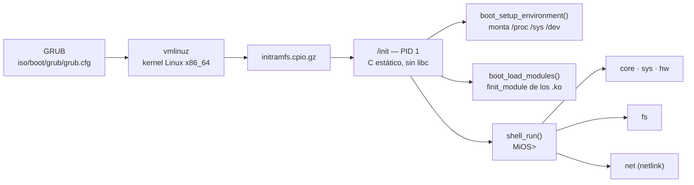

<div align="center">


**Sistema operativo mínimo para x86_64: el PID 1 es un programa en C, estático y sin libc.**


</div>

---

## ¿Qué es MiOS?

**MiOS** es un sistema mínimo que arranca sobre el kernel Linux: en vez de usar
`systemd`, `busybox` o cualquier userspace tradicional, el **PID 1 lo escribe
el propio proyecto en C**, compilado de forma estática y **sin libc**
(`-nostdlib -ffreestanding`). Todo lo que el sistema necesita —consola, lectura
de `/proc` y `/sys`, sistema de archivos, módulos del kernel y red— se pide
directamente al kernel con **syscalls x86_64**.

El resultado es un `init` de ~48 KB que arranca desde una ISO con GRUB, monta
`/proc`, `/sys` y `/dev`, carga los módulos de red del `initramfs` y deja al
usuario en una shell propia con **34 comandos**.

```
================================
  MiOS 0.5
  Consola del sistema
================================
Escribe 'help' para ver los comandos.

Cargando modulos de red...
  e1000    cargado
  e1000e   ya estaba cargado
MiOS> info
```

## Captura real de la consola

Salida **real** del `/init` de MiOS ejecutándose (banner, `uname`, `info`, `hw`,
`net`, `routes`, `dev` y `help`):

<div align="center">

</div>

> La captura viene de ejecutar el binario real `initramfs/init` con el kernel
> `6.8.0-100-generic` del anfitrión. Por eso la carga de módulos aparece como
> *no encontrado*: en la ISO esos `.ko` sí están dentro del `initramfs`, en
> `/lib/modules/<release>/`.

## Características

| Área | Qué hace |
| --- | --- |
| **Arranque** | Monta `proc`, `sysfs` y `devtmpfs`; crea `/dev/console` si falta y muestra el banner |
| **Sin libc** | Implementa su propia librería: texto, memoria, consola, conversión y `errno` |
| **Shell propia** | Parser de línea + registro de comandos por subsistemas (`shell_register`) |
| **Módulos** | Carga `.ko` con `finit_module` (sin `modprobe`), en varios pases para resolver dependencias |
| **Hardware** | CPU, núcleos, memoria, dispositivos PCI y NIC leyendo `/proc` y `/sys` |
| **Sistema de archivos** | `getdents64`, `chdir`, `rename`, `unlink`, `mkdir`, `rmdir`, copia con detección de `EXDEV` |
| **Red** | Sondeo de interfaces, direcciones y rutas por **netlink**; activar/apagar enlace |
| **Consola** | Salida con formato propio y buffer de historial (`log`) |

## Arquitectura



Estructura del código:

```
src/
├── mios.h              cabecera común (versión y subsistemas)
├── lib/                librería propia: console, string, memory, convert, errno
├── kernel/             ABI del kernel x86_64 y envoltorios de syscall
├── core/               main, boot, shell, modules y comandos sys/shell/hw
├── fs/                 archivos y comandos del sistema de archivos
└── net/                red: netlink, sondeo de interfaces/rutas y comandos
```

| Módulo | Archivos clave |
| --- | --- |
| Entrada y arranque | `src/core/main.c`, `src/core/boot.c`, `src/core/modules.c` |
| Shell | `src/core/shell.c`, `src/core/cmd_shell.c` |
| Syscalls | `src/kernel/syscall.c`, `src/kernel/syscall.h` |
| Sistema de archivos | `src/fs/file.c`, `src/fs/cmd_fs.c` |
| Red | `src/net/netlink.c`, `src/net/net.c`, `src/net/cmd_net.c` |

## Comandos

<details open>
<summary><b>34 comandos</b> (salida real de <code>help</code>)</summary>

**Shell**

| Comando | Descripción |
| --- | --- |
| `help` | Muestra los comandos |
| `clear` | Limpia la pantalla |
| `echo` | Repite el texto indicado |
| `exit` | Avisa de que el PID 1 no termina |

**Sistema**

| Comando | Descripción |
| --- | --- |
| `info` | Información del sistema |
| `uname` | Información del kernel |
| `uptime` | Tiempo desde el arranque |
| `mods` | Módulos del kernel cargados |
| `loadmods` | Carga los módulos de red |
| `loadmod` | Carga un módulo: `loadmod <ruta.ko>` |
| `drivers` | Estado de los drivers de red |
| `klog` | Mensajes del kernel (`/dev/kmsg`) |
| `log` | Historial de la consola |
| `reboot` | Reinicia la máquina |
| `poweroff` | Apaga la máquina |

**Hardware**

| Comando | Descripción |
| --- | --- |
| `hw` | Estado del hardware (CPU, RAM) |
| `pci` | Dispositivos PCI y su driver |
| `nic` | Dispositivo PCI de red y driver |

**Archivos**

| Comando | Descripción |
| --- | --- |
| `pwd` | Directorio actual |
| `ls` | Lista archivos |
| `cd` | Cambia de directorio |
| `cat` | Muestra un archivo |
| `cp` | Copia archivos |
| `mv` | Mueve o renombra archivos |
| `rm` | Elimina archivo o directorio |
| `mkdir` | Crea un directorio |
| `rmdir` | Elimina un directorio |
| `touch` | Crea un archivo vacío |

**Red**

| Comando | Descripción |
| --- | --- |
| `net` | Estado de las interfaces de red (`net <if>` para detalle) |
| `routes` | Tabla de rutas |
| `wifi` | Interfaces wifi detectadas |
| `netup` | Activa una interfaz: `netup <if>` |
| `netdown` | Apaga una interfaz: `netdown <if>` |
| `dev` | Interfaces en `/sys/class/net` |

</details>

## Compilar

Dependencias (una vez):

```bash
sudo apt install gcc make binutils cpio gzip grub-pc-bin grub-common xorriso mtools
```

Ejecutar el build completo (compila → empaqueta el `initramfs` → genera la ISO):

```bash
chmod +x build.sh
./build.sh
```

El script hace cuatro pasos:

1. Compila todos los `src/**/*.c` en `initramfs/init`
   (`gcc -static -nostdlib -no-pie -ffreestanding -Wl,-e,_start`).
2. Empaqueta `initramfs/` en `iso/boot/initramfs.cpio.gz` con `cpio` + `gzip -9`.
3. Verifica el ejecutable y los artefactos.
4. Genera `MiOS.iso` con `grub-mkrescue`.

### Reconstrucción automática

```bash
sudo apt install inotify-tools
./watch.sh
```

`watch.sh` vigila `src/` y vuelve a lanzar el build cada vez que guardas un
`.c`/`.h`.

## Ejecutar

Arranca la ISO en una máquina virtual:

```bash
qemu-system-x86_64 -m 1G -cdrom MiOS.iso
```

En GRUB elige la entrada de MiOS y espera la consola. En VMware funciona con la
NIC `e1000`, que es la que se ve en la captura (`ens33` → `e1000`).

## Notas técnicas

- **Sin libc:** no hay `printf`, `malloc` ni `readline` del sistema; todo está en
  `src/lib`. La consola escribe con sus propias rutinas de formato.
- **PID 1:** MiOS no puede terminar; `exit` solo lo recuerda. `reboot` y
  `poweroff` usan `reboot(2)` con los *magic numbers*.
- **Módulos:** `boot_load_modules()` prueba hasta 3 pasadas para respetar el
  orden de dependencias (por ejemplo `mii` antes de `pcnet32`), e informa de
  cada `.ko` como *cargado*, *ya estaba cargado*, *no encontrado* o *error*.
- **Red:** el sondeo usa `NETLINK_ROUTE` (`RTM_GETLINK`, `RTM_GETADDR`,
  `RTM_GETROUTE`) y `netup`/`netdown` cambian el estado con `RTM_NEWLINK`.
- **Versión del kernel:** la ruta de los módulos se construye con el `release`
  de `uname()`, así que no hay versión fijada a mano.

## Documentación

- [Guía: kernel, initramfs e ISO](Guia_MiOS_kernel_initramfs_ISO.md)
- [Guía: init en C estático para initramfs](Guia_MiOS_init_c_estatico_initramfs_ISO.md)

## Branding

| Archivo | Uso |
| --- | --- |
| [`docs/assets/mios-banner.png`](docs/assets/mios-banner.png) | Banner principal (1600×480) |
| [`docs/assets/mios-logo.png`](docs/assets/mios-logo.png) | Logo / icono (512×512) |
| [`docs/assets/mios-shell.png`](docs/assets/mios-shell.png) | Captura real de la consola |
| `docs/assets/*.svg` | Fuentes vectoriales del logo y el banner |

<div align="center">

</div>

## Estado del proyecto

MiOS está en desarrollo activo y es **experimental**: se prueba en máquinas
virtuales (VMware / QEMU). La ISO generada (`MiOS.iso`, ~20 MB) **no se
versiona** en el repositorio (`*.iso` está en `.gitignore`); se regenera con
`./build.sh`.

---

<div align="center">
<sub>MiOS v0.5 — PID 1 en C, sin libc · <code>github.com/Chichimokers/MiOS</code></sub>
</div>
